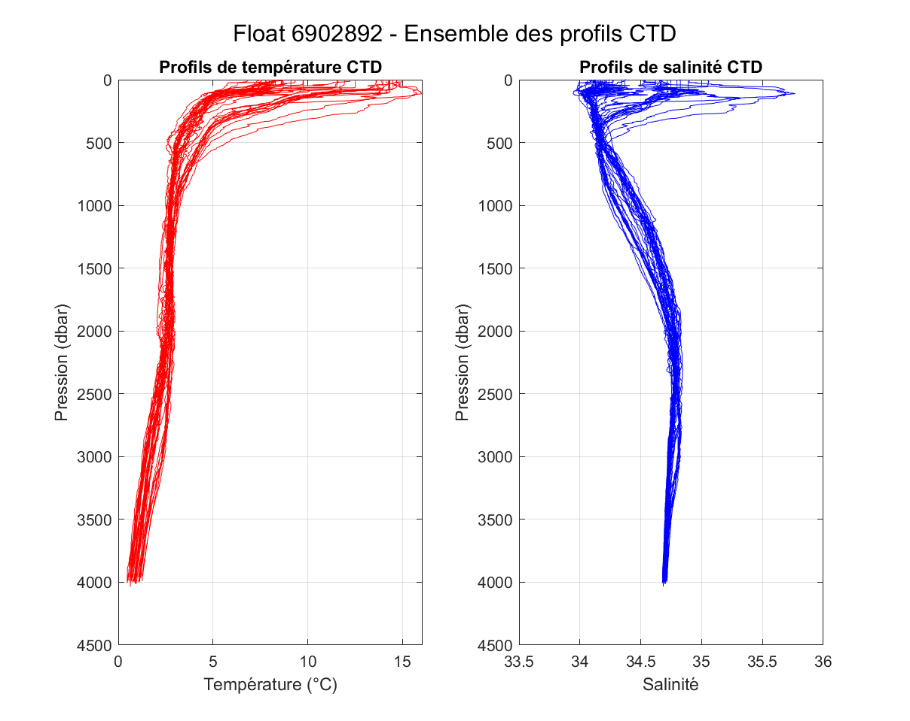

# Mise en place du décodeur Argo Coriolis en environnement MATLAB local

## 1. Objet

Cette procédure décrit la mise en place d'une installation locale du
décodeur Argo Coriolis sous Windows, à partir du code MATLAB distribué
sur SEANOE.

L'installation utilise également certains fichiers de démonstration
fournis dans le dépôt GitHub de la version conteneurisée. **La version
conteneurisée n'est pas utilisée pour exécuter le décodeur** : son
répertoire de démonstration sert uniquement de source pour récupérer les
fichiers d'exemple nécessaires aux essais, en particulier les fichiers
bruts Iridium (`co_...txt`) et les journaux RSYNC (`rsync_...txt`).

Le fonctionnement décrit ici repose sur MATLAB et sur le code source du
décodeur téléchargé séparément.

## 2. Sources des fichiers

### 2.1. Code source MATLAB du décodeur

Le code source du décodeur a été téléchargé depuis SEANOE :

-   Page de téléchargement :
    <https://www.seanoe.org/data/00345/45589/#120353>
-   Identifiant de version téléchargée : `decArgo_20250516_076a`

L'archive téléchargée a été décompressée dans le répertoire :

``` text
C:\Coriolis_Argo\decArgo_20250516_076a\
```

Ce répertoire contient le code MATLAB du décodeur, les fonctions
associées, les fichiers de configuration génériques, les informations
sur les flotteurs et la documentation technique.

Il constitue la **source logicielle de l'installation locale**.

### 2.2. Fichiers de démonstration

Les fichiers de démonstration ne sont pas récupérés dans l'archive
MATLAB téléchargée sur SEANOE. Ils sont disponibles dans le dépôt GitHub
consacré à la version conteneurisée :

<https://github.com/euroargodev/Coriolis-data-processing-chain-for-Argo-floats-container>

Le répertoire `decArgo_demo` de ce dépôt a été récupéré afin de disposer
d'un jeu de données d'exemple pour effectuer les premiers essais.

Dans cette démonstration, on réutilise notamment :

-   les fichiers bruts Iridium, dont les noms commencent par `co_` ;
-   les fichiers journaux RSYNC, dont les noms commencent par `rsync_` ;
-   les fichiers JSON d'information et de métadonnées des flotteurs.

**Important :** le dépôt conteneurisé est utilisé uniquement comme
source de fichiers de démonstration. Docker, Docker Compose, les scripts
de lancement du conteneur et l'environnement MATLAB Runtime conteneurisé
ne sont pas utilisés. Le décodage est exécuté directement avec MATLAB
installé localement.

Le répertoire de démonstration utilisé pour les essais est placé ici :

``` text
C:\Coriolis_Argo\decArgo_demo\
```

## 3. Organisation locale des répertoires

Les deux répertoires téléchargés/récupérés sont regroupés sous une même
racine de travail :

``` text
C:\Coriolis_Argo\
│
├── decArgo_20250516_076a\
│   ├── decArgo_config_floats\
│   ├── decArgo_doc\
│   └── decArgo_soft\
│
├── decArgo_demo\
│   ├── config\
│   ├── input\
│   └── output\
│
├── test_dec_vio.m
└── 120353.7z
```

Les deux répertoires principaux ont des rôles différents :
-  `decArgo_20250516_076a`  Code source MATLAB du décodeur et ressources associées

-  `decArgo_demo` Configuration locale de test, données d'entrée et résultats du décodage

Cette séparation permet de conserver le code source du décodeur
indépendant des données traitées et des résultats produits.

## 4. Organisation du code source MATLAB

Le répertoire :

``` text
C:\Coriolis_Argo\decArgo_20250516_076a\
```

contient principalement les éléments suivants :

``` text
decArgo_20250516_076a\
│
├── decArgo_config_floats\
│   ├── argoFloatInfo\
│   ├── json_float_info\
│   ├── json_float_meta_argos\
│   ├── json_float_meta_ir_rudics_remocean\
│   ├── json_float_meta_ir_sbd\
│   └── json_float_meta_ir_sbd_remocean\
│
├── decArgo_doc\
│   ├── coriolis_aux_format\
│   ├── coriolis_ice_floats_audit\
│   ├── decoder_user_manual\
│   ├── decoder_versions\
│   ├── DOXY_ADJUSTED_ERROR_specification\
│   ├── float_user_manuals\
│   ├── implementation_of_RTQC_at_coriolis\
│   └── ...
│
└── decArgo_soft\
    ├── config\
    │   ├── configuration_sample_files\
    │   ├── _configParamNames\
    │   └── _techParamNames\
    │
    └── soft\
        ├── decode_argo_2_nc_rt.m
        ├── ...
        ├── sub\
        ├── sub_foreign\
        ├── util\
        └── util2\
```

### 4.1. `decArgo_config_floats`

Ce répertoire contient les fichiers génériques d'information et de
configuration des flotteurs fournis avec le code source.

Il regroupe notamment des informations générales sur les flotteurs ainsi
que des fichiers JSON associés aux différents modes de transmission
(Argos, Iridium SBD, Iridium RUDICS et variantes).

Pour l'installation de test décrite dans cette procédure, les fichiers
propres aux flotteurs utilisés sont placés dans le répertoire
`decArgo_demo/config/decArgo_config_floats`. C'est ce dernier
emplacement qui est référencé dans le fichier de configuration local
`decoder_conf.json`.

### 4.2. `decArgo_doc`

Ce répertoire contient la documentation technique du décodeur : manuel
utilisateur, documentation des formats, informations sur les traitements
et contrôles qualité, ainsi que des documents spécifiques aux familles
de flotteurs.

Le manuel utilisateur présent dans l'installation est notamment :

``` text
decArgo_doc\decoder_user_manual\argo_coriolis_matlab_decoder_V1.9_20250303.pdf
```

### 4.3. `decArgo_soft`

Ce répertoire contient le logiciel de décodage.

-   `config` contient les fichiers de configuration génériques et les
    nomenclatures de paramètres.
-   `soft` contient les programmes MATLAB du décodeur et leurs fonctions
    associées.

Les répertoires `sub`, `sub_foreign`, `util` et `util2` regroupent les
fonctions secondaires et utilitaires appelés par les programmes
principaux.

Le programme utilisé pour le décodage temps réel est :

``` text
decArgo_soft\soft\decode_argo_2_nc_rt.m
```

Le script de lancement local `start_decode.m` est placé dans :

``` text
decArgo_soft\soft\util\start_decode.m
```

## 5. Organisation du répertoire de démonstration local

Le répertoire de travail de démonstration est :

``` text
C:\Coriolis_Argo\decArgo_demo\
```

Son organisation utilisée pour les essais est la suivante :

``` text
decArgo_demo\
│
├── config\
│   ├── decoder_conf.json
│   └── decArgo_config_floats\
│       ├── json_float_info\
│       └── json_float_meta_ir_sbd\
│
├── input\
│   ├── archive\
│   │   └── cycle\
│   │       ├── 300234065895840\
│   │       └── 300234068508780\
│   │
│   └── rsync_list\
│       ├── 300234065895840\
│       └── 300234068508780\
│
└── output\
    ├── csv\
    ├── iridium\
    ├── log\
    ├── nc\
    └── xml\
```

### 5.1. `config`

Le répertoire `config` contient le fichier de configuration général
`decoder_conf.json` et les fichiers JSON propres aux flotteurs de
démonstration.

Les fichiers présents lors des essais sont notamment :

``` text
config\
├── decoder_conf.json
└── decArgo_config_floats\
    ├── json_float_info\
    │   ├── 6902892_300234065895840_info.json
    │   └── 6903014_300234068508780_info.json
    │
    └── json_float_meta_ir_sbd\
        ├── 6902892_meta.json
        └── 6903014_meta.json
```

Le fichier `decoder_conf.json` est le fichier de configuration utilisé
par le lancement local. Les sous-répertoires `json_float_info` et
`json_float_meta_ir_sbd` contiennent les informations et métadonnées
nécessaires aux flotteurs testés.

### 5.2. `input/archive/cycle` : fichiers bruts Iridium

Ce répertoire contient les fichiers bruts transmis par les flotteurs via
Iridium.

Les données sont rangées dans un sous-répertoire portant l'identifiant
de transmission du flotteur :

``` text
input\archive\cycle\
├── 300234065895840\
│   ├── co_20200629T083042Z_300234065895840_000004_000000_20420.txt
│   └── ...
│
└── 300234068508780\
    └── ...
```

Les fichiers `co_...txt` constituent les messages bruts à décoder. Il
faut conserver leur nom et leur organisation par identifiant de
transmission.

### 5.3. `input/rsync_list` : journaux RSYNC

Ce répertoire contient les fichiers journaux RSYNC associés aux
transmissions :

``` text
input\rsync_list\
├── 300234065895840\
│   ├── rsync_20200629T092506Z.txt
│   └── ...
│
└── 300234068508780\
    └── ...
```

Ces fichiers sont distincts des messages bruts `co_...txt`. Ils sont
utilisés par le décodeur pour identifier les transmissions et
sélectionner les données à traiter.

Dans le lancement configuré ici, le décodeur est appelé avec `rsynclog`
et la valeur `all`, afin de traiter les journaux RSYNC disponibles pour
le flotteur sélectionné.

### 5.4. `output` : résultats du décodage

Le répertoire `output` reçoit les résultats du traitement.

Les répertoires `csv` , `nc` ,`log`, `xml` et
`iridium`ont été créés manuellement lors de la
préparation de l'environnement local. 

Le répertoire `nc` reçoit les fichiers NetCDF. Lors du premier décodage
du flotteur WMO 6902892, la chaîne a créé automatiquement le
sous-répertoire `6902892`, puis ses sous-répertoires `auxiliary` et
`profiles`.

Exemple de résultats obtenus :

``` text
output\nc\
└── 6902892\
    ├── 6902892_meta.nc
    ├── 6902892_Rtraj.nc
    ├── 6902892_tech.nc
    ├── auxiliary\
    │   ├── 6902892_meta_aux.nc
    │   └── 6902892_tech_aux.nc
    └── profiles\
        ├── BR6902892_001.nc
        ├── BR6902892_001D.nc
        ├── BR6902892_002.nc
        └── ...
```

Le répertoire `log` contient les journaux d'exécution, par exemple :

``` text
decode_argo_2_nc_rt_20261124T174557Z.log
```

Le répertoire `xml` contient les fichiers XML produits pendant le
traitement, par exemple :

``` text
co041404_20261124T174557Z.xml
```

## 6. Adaptation des fichiers pour le lancement local

Le répertoire de démonstration d'origine est prévu pour l'environnement
conteneurisé. Pour l'utiliser avec le code MATLAB local, deux fichiers
ont été adaptés :

1.  `start_decode.m`, pour indiquer où se trouvent le code source et le
    fichier de configuration sur le poste Windows ;
2.  `decoder_conf.json`, pour indiquer les chemins locaux des données
    d'entrée et des répertoires de sortie.

Les scripts Docker et les fichiers de lancement de la version
conteneurisée ne sont pas utilisés.

## 7. Modification du script `start_decode.m`

### 7.1. Emplacement du script

Le script utilisé est celui du code source MATLAB :

``` text
C:\Coriolis_Argo\decArgo_20250516_076a\decArgo_soft\soft\util\start_decode.m
```

Il a été adapté à l'arborescence locale. Il ne faut pas le confondre
avec les scripts de lancement présents dans le dépôt conteneurisé.

### 7.2. Paramètres adaptés

Le script définit le flotteur à traiter :

``` matlab
wmoList = [6902892];
```

Le chemin du fichier de configuration local est indiqué explicitement :

``` matlab
configFile = 'C:/Coriolis_Argo/decArgo_demo/config/decoder_conf.json';
```

Le chemin du code MATLAB du décodeur est également défini :

``` matlab
softPath = 'C:/Coriolis_Argo/decArgo_20250516_076a/decArgo_soft/soft';
```

Le script ajoute le répertoire `soft` et tous ses sous-répertoires au
chemin MATLAB grâce à :

``` matlab
addpath(genpath(softPath))
```

Il lance ensuite une seconde instance de MATLAB, sans interface
graphique, pour exécuter la fonction `decode_argo_2_nc_rt`.

### 7.3. Script `start_decode.m` utilisé

Le contenu actuellement utilisé est :

``` matlab
function start_decode

wmoList = [6902892];

configFile = 'C:/Coriolis_Argo/decArgo_demo/config/decoder_conf.json';

nbFloats = 1;
floatNum = 0;
for idFloat = length(wmoList):-1:1
   floatNumStr = num2str(wmoList(idFloat));
   fprintf('%d/%d : %s\n', floatNum+1, nbFloats, floatNumStr);

   softPath = 'C:/Coriolis_Argo/decArgo_20250516_076a/decArgo_soft/soft';

   cmd = ['matlab -nodesktop -nosplash -r "addpath(genpath(''' softPath ''')); decode_argo_2_nc_rt(''rsynclog'', ''all'', ''configfile'', ''' configFile ''', ''floatwmo'', ''' floatNumStr '''); exit"'];
   tic;
   system(cmd);
   ellapsedTime = toc;
   fprintf('Done (%.1f min)\n', ellapsedTime/60);

   floatNum = floatNum + 1;
   if (floatNum == nbFloats)
      break
   end
end

return
```

Pour traiter un autre flotteur, modifier la liste `wmoList` avec le ou
les numéros WMO souhaités. Le nombre `nbFloats` doit être cohérent avec
le nombre de flotteurs à traiter ; dans la configuration actuelle, un
seul flotteur est lancé.

## 8. Modification du fichier `decoder_conf.json`

### 8.1. Emplacement du fichier

Le fichier de configuration utilisé est :

``` text
C:\Coriolis_Argo\decArgo_demo\config\decoder_conf.json
```

Il s'agit du fichier de configuration de la démonstration, adapté aux
chemins de l'installation locale. C'est ce fichier qui est transmis à
`decode_argo_2_nc_rt` par le script `start_decode.m`.

### 8.2. Chemins des données d'entrée

Les chemins suivants ont été configurés pour pointer vers les
répertoires locaux :

| Paramètre | Chemin configuré |
|---|---|
| `DIR_INPUT_JSON_FLOAT_DECODING_PARAMETERS_FILE` | `C:/Coriolis_Argo/decArgo_demo/config/decArgo_config_floats/json_float_info/` |
| `DIR_INPUT_RSYNC_DATA` | `C:/Coriolis_Argo/decArgo_demo/input/archive/cycle/` |
| `DIR_INPUT_RSYNC_LOG` | `C:/Coriolis_Argo/decArgo_demo/input/rsync_list/` |
| `DIR_INPUT_JSON_FLOAT_META_DATA_FILE` | `C:/Coriolis_Argo/decArgo_demo/config/decArgo_config_floats/json_float_meta_ir_sbd/` |
| `DIR_INPUT_JSON_TECH_LABEL_FILE` | `C:/Coriolis_Argo/decArgo_20250516_076a/decArgo_soft/config/_techParamNames/` |
| `DIR_INPUT_JSON_CONF_LABEL_FILE` | `C:/Coriolis_Argo/decArgo_20250516_076a/decArgo_soft/config/_configParamNames/` |

Les répertoires de données et les fichiers JSON propres aux flotteurs
sont donc recherchés dans `decArgo_demo`, tandis que les nomenclatures
de paramètres sont recherchées dans le code source téléchargé depuis
SEANOE `decArgo_20250516_076a`.

### 8.3. Chemins des répertoires de sortie

Les répertoires de sortie sont configurés comme suit :

| Paramètre | Chemin configuré |
|---|---|
| `DIR_OUTPUT_LOG_FILE` | `C:/Coriolis_Argo/decArgo_demo/output/log/` |
| `DIR_OUTPUT_CSV_FILE` | `C:/Coriolis_Argo/decArgo_demo/output/csv/` |
| `DIR_OUTPUT_XML_FILE` | `C:/Coriolis_Argo/decArgo_demo/output/xml/` |
| `DIR_OUTPUT_NETCDF_FILE` | `C:/Coriolis_Argo/decArgo_demo/output/nc/` |
| `DIR_OUTPUT_NETCDF_TRAJ_3_1_FILE` | `C:/Coriolis_Argo/decArgo_demo/output/nc/` |
| `DIR_OUTPUT_NETCDF_TRAJ_3_2_FILE` | `C:/Coriolis_Argo/decArgo_demo/output/nc/` |


### 8.4. Type de transmission et formats générés

Dans la configuration utilisée pour le premier essai, les paramètres
principaux sont :

``` json
"FLOAT_TRANSMISSION_TYPE" : "3",
"GENERATE_NC_MULTI_PROF" : "0",
"GENERATE_NC_MONO_PROF" : "2",
"GENERATE_NC_TECH" : "2",
"GENERATE_NC_META" : "2",
"GENERATE_NC_TRAJ_3_1" : "0",
"GENERATE_NC_TRAJ_3_2" : "2",
"APPLY_RTQC" : "0"
```

Ces valeurs sont celles du fichier de configuration utilisé pour
l'essai. Elles sont conservées ici comme référence de la configuration
testée ; elles ne doivent pas être modifiées sans vérifier leur
signification dans le manuel du décodeur et les besoins du traitement.

### 8.5. Chemins Linux conservés dans le fichier

Le fichier contient encore plusieurs chemins de type Linux, notamment :

``` text
/mnt/data/config/decArgo_config_floats/float_dm_buffer_lists
/mnt/data/output/iridium/
/tmp
/mnt/ref/gebco.nc
/tmp/ar_exclusionlist.txt
/mnt/ref/woa13_all_n00_01.nc
/mnt/ref/SLOPE_RT_2024.txt
```

Ces chemins proviennent de la configuration de démonstration destinée à
l'environnement conteneurisé. Ils n'ont pas été remplacés dans la
configuration locale actuelle.

Le premier essai de décodage a néanmoins produit des fichiers NetCDF.
Certains paramètres ne sont donc pas sollicités par le jeu
de données de démo et les options utilisées. Leur adaptation devra être étudiée
si les traitements futurs nécessitent les fonctions correspondantes.

## 9. Lancement du décodage

Ouvrir MATLAB, puis se placer dans le répertoire contenant
`decoder_conf.json` :

``` matlab
clear all
addpath('C:\Coriolis_Argo\decArgo_20250516_076a\decArgo_soft\soft\')
start_decode
```

Le script lance une seconde instance de MATLAB et appelle le décodeur
avec les paramètres suivants :

``` matlab
decode_argo_2_nc_rt( ...
    'rsynclog', 'all', ...
    'configfile', configFile, ...
    'floatwmo', floatNumStr)
```

Le flotteur traité est celui indiqué dans `wmoList` dans
`start_decode.m`.

## 10. Vérification des résultats

À la fin du traitement, vérifier la présence des fichiers pour le flotteur WMO 6902892 dans :

``` text
C:\Coriolis_Argo\decArgo_demo\output\nc\6902892\
```

Un contrôle de lecture a été réalisé dans MATLAB sur un profil généré :

``` matlab
ncdisp('C:\Coriolis_Argo\decArgo_demo\output\nc\6902892\profiles\BR6902892_001.nc')
```

Le fichier a été reconnu comme un profil vertical Argo au format NetCDF,
avec notamment les attributs globaux :

-   `title = 'Argo float vertical profile'`
-   `institution = 'CORIOLIS'`

Le journal d'exécution correspondant est disponible dans `output/log`.


Pour visualiser les données décodées et stockées dans les fichiers .nc, voici des éléments de code Matlab :

``` matlab
folder = 'C:/Coriolis_Argo/decArgo_demo/output/nc/6902892/profiles/';

files = dir([folder 'R*.nc']);

figure;

subplot(1,2,1);
hold on;
grid on;
box on;
title('Profils de température CTD');
xlabel('Température (°C)');
ylabel('Pression (dbar)');
set(gca,'YDir','reverse');

subplot(1,2,2);
hold on;
grid on;
box on;
title('Profils de salinité CTD');
xlabel('Salinité');
ylabel('Pression (dbar)');
set(gca,'YDir','reverse');

for k = 1:length(files)

    f = [folder files(k).name];

    try
        P = double(ncread(f,'PRES'));
        T = double(ncread(f,'TEMP'));
        S = double(ncread(f,'PSAL'));

        % Valeurs manquantes
        P(P == 99999) = NaN;
        T(T == 99999) = NaN;
        S(S == 99999) = NaN;

        % Tracé de chaque profil
        subplot(1,2,1);
        plot(T,P,'r');

        subplot(1,2,2);
        plot(S,P,'b');

    catch
        fprintf('Fichier ignoré : %s\n',files(k).name);
    end
end

sgtitle('Float 6902892 - Ensemble des profils CTD');

```


## 11. Références et sources

-   **Code source MATLAB du décodeur -- SEANOE :**
    <https://www.seanoe.org/data/00345/45589/#120353>
-   **Dépôt de la version conteneurisée -- utilisé uniquement pour
    récupérer les fichiers de démonstration :**
    <https://github.com/euroargodev/Coriolis-data-processing-chain-for-Argo-floats-container>
-   **Manuel utilisateur fourni avec le code source :**
    `decArgo_doc/decoder_user_manual/argo_coriolis_matlab_decoder_V1.9_20250303.pdf`

------------------------------------------------------------------------

**État de la procédure :** cette documentation décrit l'installation
locale et le premier décodage réalisé avec le flotteur WMO 6902892. Les
chemins Linux encore présents dans `decoder_conf.json` et les paramètres
non sollicités lors de cet essai restent à examiner avant une
généralisation à d'autres flotteurs et configurations.
